# 🤖 CV-scout: AI-Powered Job Matching Telegram Bot

An end-to-end AI system that matches a user's resume with real IT job vacancies. The bot scrapes live data from HeadHunter, extracts key skills and requirements using LLM (GigaChat), and applies semantic vector search to instantly find and score the best matches.

## 🎥 English Demo

<p align="center">
  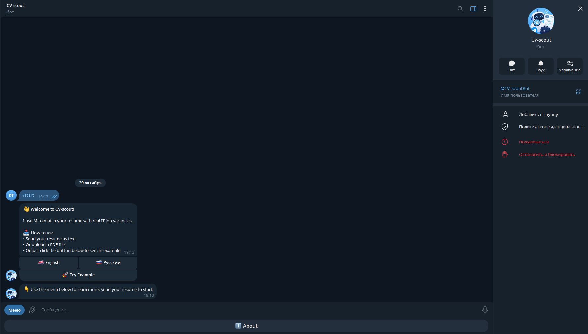
  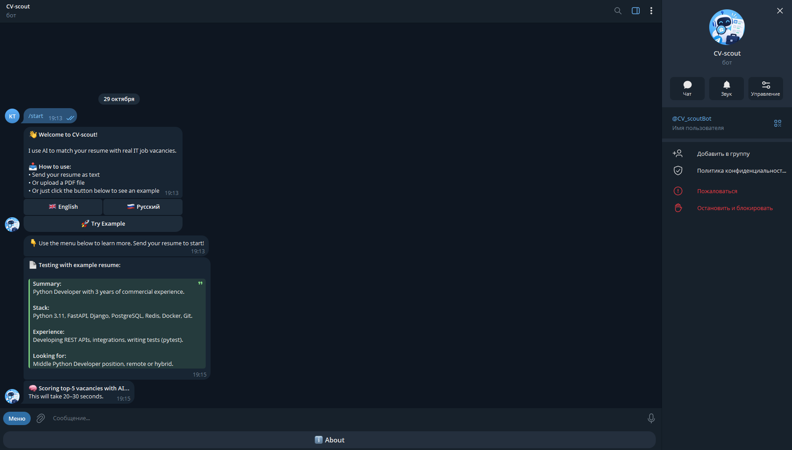
  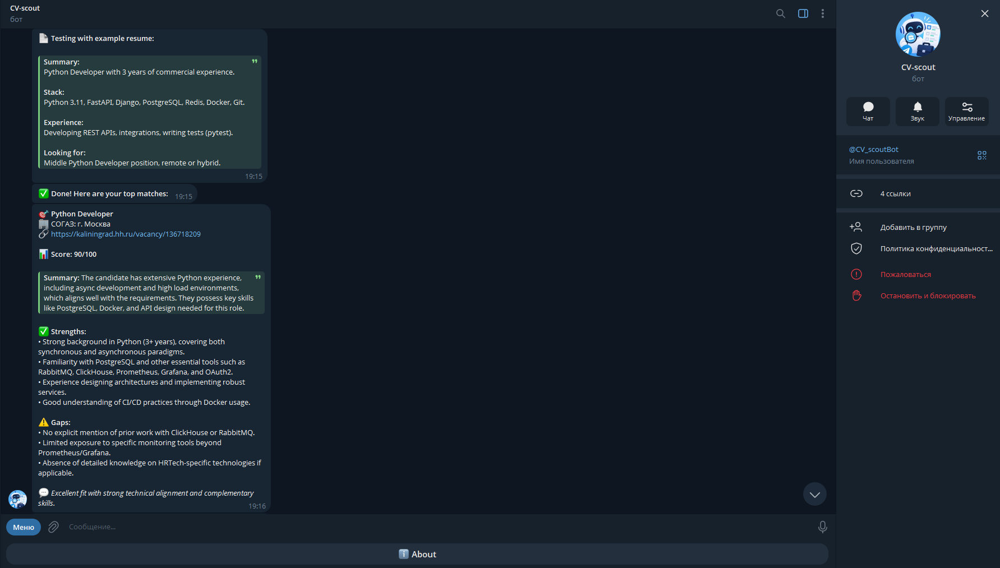
  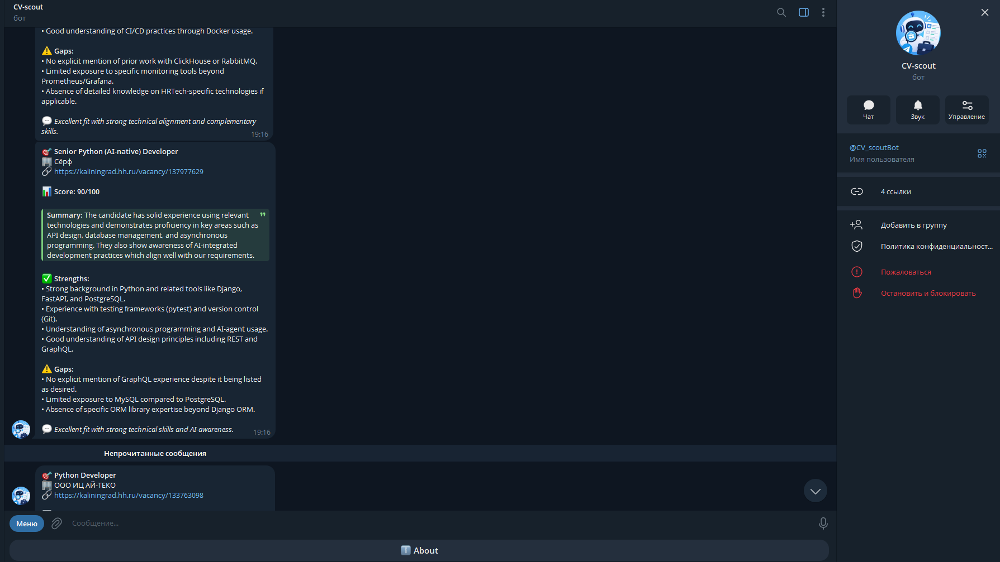
  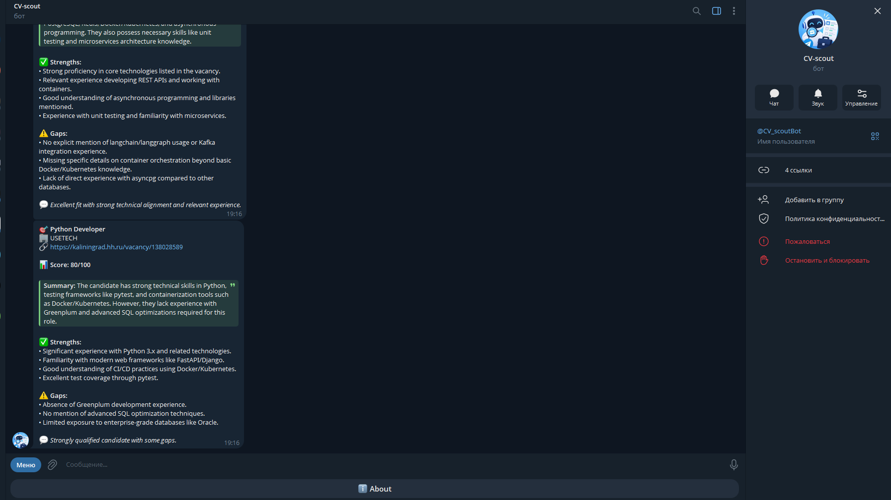
  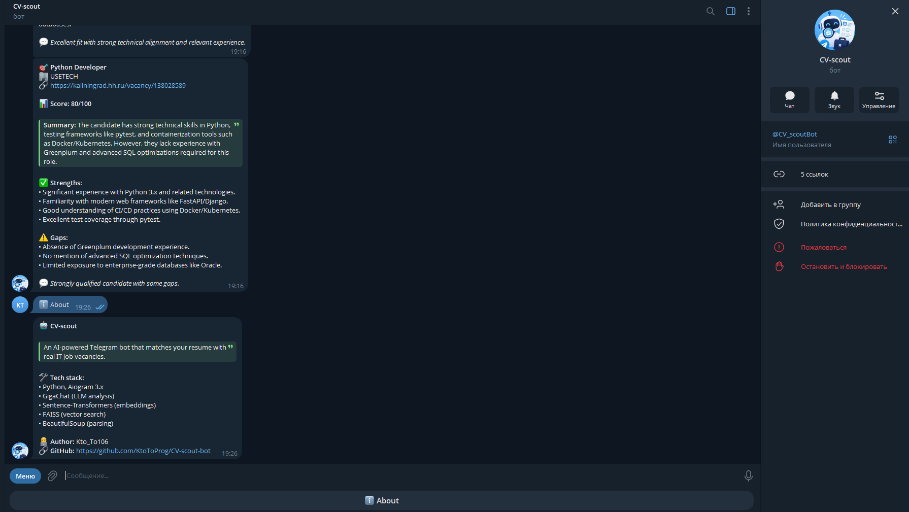
</p>

## ✨ Key Features

*   **Real-time Data Collection:** Asynchronously parses IT vacancies from HeadHunter (hh.ru).
*   **AI-Driven Extraction:** Uses GigaChat (LLM) to extract tech stack, seniority level, and key requirements from unstructured job descriptions.
*   **Semantic Search (RAG):** Converts text into vector embeddings (`sentence-transformers`) and uses `FAISS` to instantly find the top-10 semantically closest vacancies.
*   **Intelligent Scoring:** Evaluates the candidate's resume against vacancies, providing a 0-100 match score, a summary, and highlights strengths and gaps.
*   **PDF Resume Parsing:** Users can upload their resumes directly as PDF files.
*   **Multi-language Interface:** Full support for English and Russian languages.
*   **Containerized:** Ready for easy deployment via Docker.

## 🧠 How it works (Architecture)

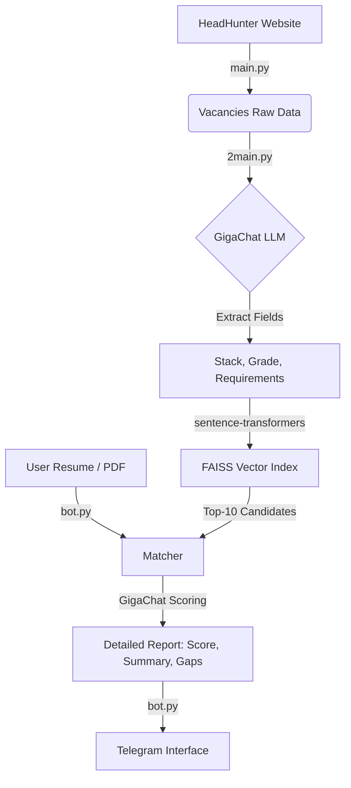

## 📂 Project Structure

*   `.dockerignore` — Specifies files and directories to exclude from the Docker build context.
*   `.env.example` — Template for environment variables (API keys, tokens).
*   `.gitignore` — Specifies files to ignore in Git (secrets, databases).
*   `2main.py` — Data processor. Passes each vacancy through GigaChat to extract structured data and saves it to `vacancies_analyzed.json`.
*   `Dockerfile` — Instructions for building the Docker image.
*   `LICENSE` — MIT License for the project.
*   `README.md` — Project documentation and setup instructions.
*   `bot.py` — The Telegram interface built with `Aiogram 3.x`. Handles user input, PDF parsing, SQLite database, and displays the final reports.
*   `docker-compose.yml` — Configuration for running the application via Docker Compose.
*   `main.py` — Asynchronous scraper for HeadHunter. Collects raw vacancies and saves them to `vacancies.json`.
*   `matcher.py` — The core engine. Handles vectorization, FAISS index construction, and the final LLM-scoring logic.
*   `requirements.txt` — List of Python dependencies required to run the project.
*   `russian_trusted_root_ca.crt` — Root certificate required for secure connection to GigaChat API.
*   `screenshots/` — Directory containing demo images for the README.
*   `test_matcher.py` — A standalone script to test the embedding search and scoring without running the bot.
*   `vacancies_analyzed.json` — Pre-parsed dataset of 100 IT vacancies for immediate bot testing.

## 🛠 Tech Stack

*   **Language:** Python 3.12
*   **Telegram Bot Framework:** Aiogram 3.x
*   **LLM API:** GigaChat (Sber)
*   **NLP & Vector Search:** Sentence-Transformers, FAISS
*   **Scraping:** BeautifulSoup4, aiohttp, lxml
*   **Database:** SQLite (aiosqlite)

---

## 🚀 How to run locally

### 1. Clone the repository and install dependencies
```bash
git clone https://github.com/KtoToProg/CV-scout-bot.git
cd CV-scout-bot
pip install -r requirements.txt
```

### 2. Environment Variables Setup
Copy the example environment file:
```bash
cp .env.example .env.py
```
Open `.env.py` and fill in your credentials:
*   `GIGACHAT_KEY`: Your Authorization Key from [developers.sber.ru](https://developers.sber.ru/)
*   `BOT_TOKEN`: Your Telegram bot token from [@BotFather](https://t.me/BotFather)
*   `TELEGRAM_PROXY_URL`: Your Cloudflare Worker URL (if you are running from a region where Telegram API is blocked).

### 3. Generate Database (Optional)
The repository already includes a pre-parsed `vacancies_analyzed.json` with 100 real IT vacancies so you can test the bot immediately. 
If you want to fetch fresh data:
```bash
python main.py
python 2main.py
```

### 4. Run the bot
```bash
python bot.py
```

---

## 🐳 How to run with Docker (Recommended)

If you have Docker installed, you can launch the entire system in one command:

```bash
docker-compose up -d --build
```

---
<br>
<br>

# 🇷🇺 Русская версия (Russian Translation)

**CV-scout** — это сквозная AI-система, которая подбирает IT-вакансии под резюме пользователя. Бот собирает данные с HeadHunter, извлекает ключевые навыки и требования с помощью языковой модели (GigaChat) и использует семантический векторный поиск для мгновенного нахождения и оценки лучших совпадений.

## 🎥 Русское демо

<p align="center">
  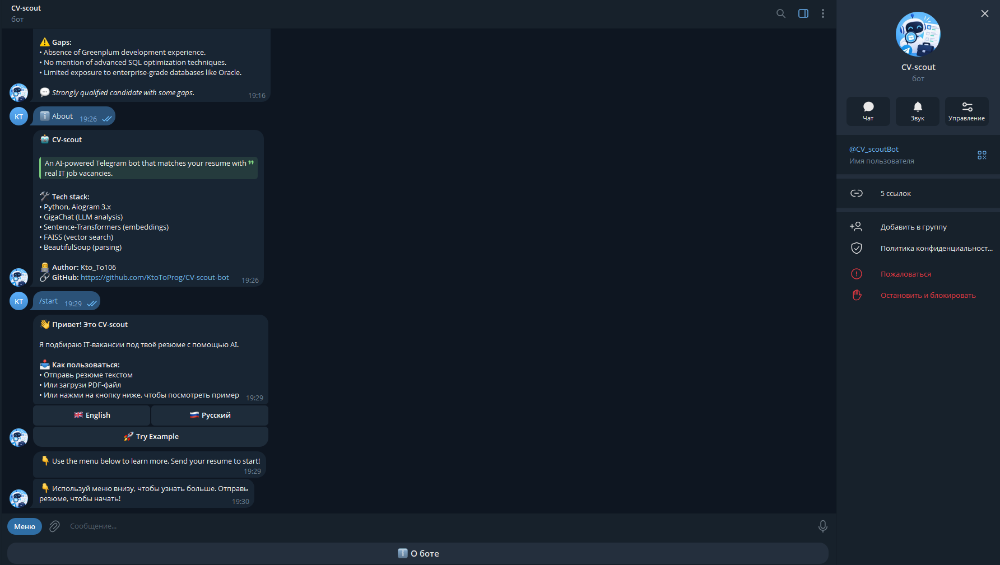
  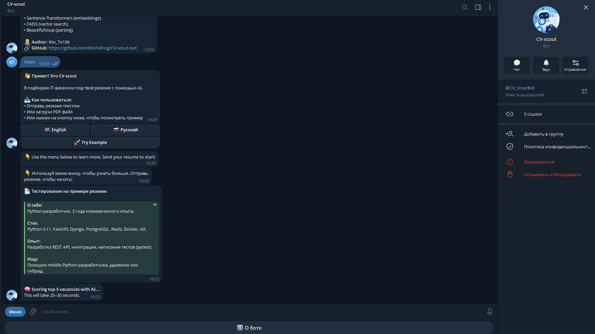
  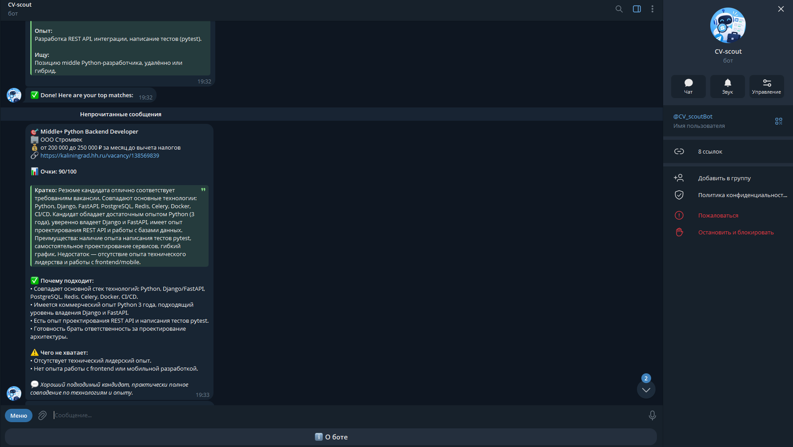
  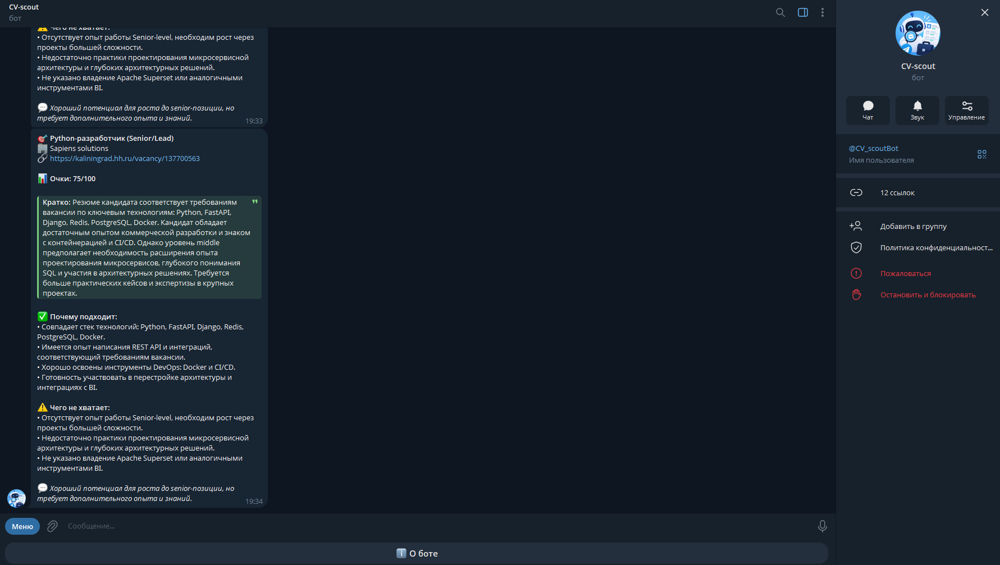
  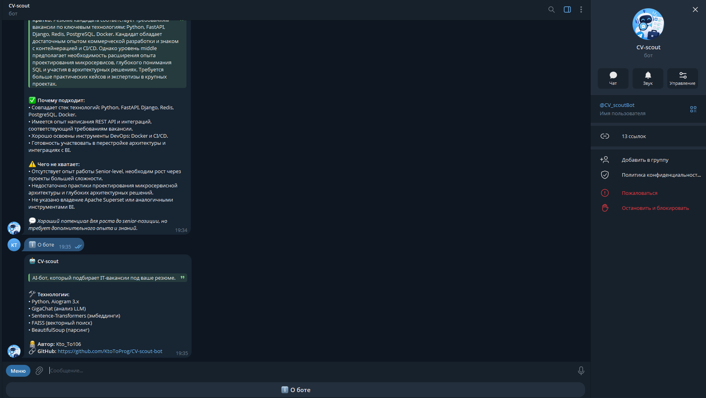
</p>

## 🧠 Как это работает (Архитектура)

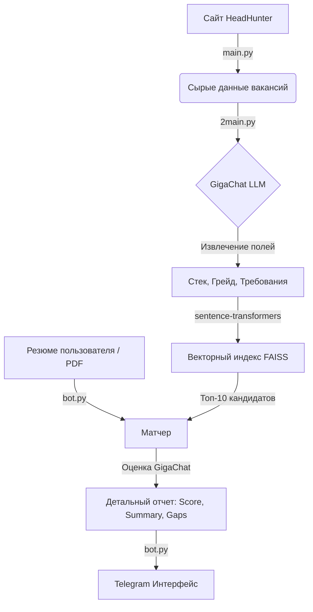

## ✨ Основные возможности

*   **Сбор данных в реальном времени:** Асинхронный парсинг IT-вакансий с сайта HeadHunter.
*   **Извлечение данных через ИИ:** Использование GigaChat для извлечения стека технологий, грейда и ключевых требований из неструктурированных описаний.
*   **Семантический поиск (RAG):** Преобразование текста в векторные эмбеддинги (`sentence-transformers`) и использование `FAISS` для мгновенного поиска топ-10 наиболее подходящих вакансий.
*   **Умная оценка:** Сравнение резюме с вакансиями с выставлением оценки от 0 до 100, написанием краткого резюме, сильных сторон и пробелов в опыте.
*   **Парсинг PDF:** Пользователи могут загружать свои резюме в формате PDF.
*   **Мультиязычный интерфейс:** Полная поддержка английского и русского языков.
*   **Контейнеризация:** Готов к развертыванию через Docker.

## 📂 Структура проекта

*   `.dockerignore` — Файлы и папки, исключаемые при сборке Docker-образа.
*   `.env.example` — Шаблон для переменных окружения (ключи API, токены).
*   `.gitignore` — Файлы, игнорируемые Git (секреты, базы данных).
*   `2main.py` — Обработчик данных. Прогоняет вакансии через GigaChat для извлечения структурированных данных и сохраняет в `vacancies_analyzed.json`.
*   `Dockerfile` — Инструкция для сборки Docker-образа.
*   `LICENSE` — Лицензия MIT для проекта.
*   `README.md` — Документация проекта и инструкции по установке.
*   `bot.py` — Telegram-интерфейс на базе `Aiogram 3.x`. Обрабатывает ввод пользователя, парсит PDF, хранит данные в SQLite и выводит финальные отчеты.
*   `docker-compose.yml` — Конфигурация для запуска приложения через Docker Compose.
*   `main.py` — Асинхронный парсер HeadHunter. Собирает сырые вакансии и сохраняет их в `vacancies.json`.
*   `matcher.py` — Ядро системы. Отвечает за векторизацию текста, построение индекса FAISS и логику финального скоринга через LLM.
*   `requirements.txt` — Список зависимостей Python.
*   `russian_trusted_root_ca.crt` — Корневой сертификат для безопасного подключения к API GigaChat.
*   `screenshots/` — Папка с демонстрационными скриншотами для README.
*   `test_matcher.py` — Отдельный скрипт для тестирования поиска и скоринга без запуска бота.
*   `vacancies_analyzed.json` — Готовый датасет из 100 IT-вакансий для тестирования бота.

## 🛠 Технологии

*   **Язык:** Python 3.12
*   **Telegram Bot Framework:** Aiogram 3.x
*   **LLM API:** GigaChat (Сбер)
*   **NLP & Векторный поиск:** Sentence-Transformers, FAISS
*   **Парсинг:** BeautifulSoup4, aiohttp, lxml
*   **База данных:** SQLite (aiosqlite)

---

## 🚀 Как запустить локально

### 1. Клонирование репозитория и установка зависимостей
```bash
git clone https://github.com/KtoToProg/CV-scout-bot.git
cd CV-scout-bot
pip install -r requirements.txt
```

### 2. Настройка переменных окружения
Скопируйте файл-пример:
```bash
cp .env.example .env.py
```
Откройте `.env.py` и заполните ключи:
*   `GIGACHAT_KEY`: Ключ авторизации из [developers.sber.ru](https://developers.sber.ru/)
*   `BOT_TOKEN`: Токен бота от [@BotFather](https://t.me/BotFather)
*   `TELEGRAM_PROXY_URL`: URL вашего Cloudflare Worker (если вы находитесь в регионе, где заблокирован API Telegram).

### 3. Генерация базы данных (Опционально)
В репозитории уже есть готовый файл `vacancies_analyzed.json` с 100 реальными вакансиями, так что бота можно тестировать сразу. 
Если хотите собрать свежие данные:
```bash
python main.py
python 2main.py
```

### 4. Запуск бота
```bash
python bot.py
```

---

## 🐳 Запуск через Docker (Рекомендуется)

Если у вас установлен Docker, вы можете запустить всю систему одной командой:

```bash
docker-compose up -d --build
```

---
## 👨‍💻 Автор
*   **GitHub:** [KtoToProg](https://github.com/KtoToProg)
*   **Telegram Bot:** [@CV_scoutBot](https://t.me/CV_scoutBot)
